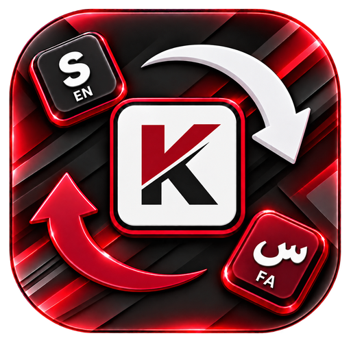

<div align="center">



# KeyFix

**متنِ تایپ‌شده با چیدمان اشتباه را با یک میانبر درست کنید.**<br>
**Fix text typed in the wrong keyboard layout with a single shortcut.**

[](https://github.com/M-D-6/KeyFix/releases)
[](LICENSE)
[-1f1f23?style=flat-square)](#installation)
[](https://flutter.dev)

[فارسی](#فارسی) · [English](#english)

</div>

---

<div dir="rtl">

## فارسی

**KeyFix** یک برنامهٔ سبک برای ویندوز است که متنِ تایپ‌شده با **زبان یا چیدمان اشتباه صفحه‌کلید** را به چیدمان درست برمی‌گرداند. متن را انتخاب کنید، میانبر را بزنید، تمام.

```
sghl   ⇄   سلام
اثممخ  ⇄   hello
```

### ✨ امکانات

- تبدیل بین چیدمان **فارسی و انگلیسی** با میانبر سراسری (پیش‌فرض: `Alt + Shift`)
- تشخیص خودکار جهت تبدیل، حتی در متن ترکیبی
- تشخیص Caps Lock برای تبدیل متن انگلیسی
- تغییر خودکار زبان صفحه‌کلید ویندوز پس از تبدیل (اختیاری)
- میانبر قابل تغییر؛ ترکیب کلیدهای کمکی یا کلیدهای مستقل مجاز، مطابق راهنمای داخل برنامه
- آیکون System Tray با منوی راست‌کلیک برای فعال/غیرفعال‌کردن، بازکردن تنظیمات و خروج
- اجرا همراه ویندوز و ادامهٔ کار در پس‌زمینه (اختیاری)
- اعلان نتیجهٔ تبدیل (اختیاری)
- رابط **فارسی و انگلیسی** با پشتیبانی از راست‌چین، تم روشن/تاریک و رنگ تأکیدی ویندوز
- بدون اتصال به اینترنت و بدون جمع‌آوری اطلاعات

### 🚀 شروع سریع

1. KeyFix را اجرا کنید؛ برنامه در System Tray قرار می‌گیرد.
2. متنی را که با چیدمان اشتباه تایپ شده انتخاب کنید.
3. میانبر را بزنید (پیش‌فرض `Alt + Shift`).

برای تغییر میانبر، گزینهٔ **Change shortcut** را در برنامه باز کنید، ترکیب جدید را ثبت و ذخیره کنید. نماد اطلاعات در پنجرهٔ میانبر، ترکیب‌های مجاز را توضیح می‌دهد.

### ⚙️ نحوهٔ کار

KeyFix متن انتخاب‌شده را با ارسال `Ctrl+C` می‌خواند، کاراکترها را با استفاده از چیدمان‌های فارسی و انگلیسی ویندوز تبدیل می‌کند و با `Ctrl+V` جایگزین می‌کند. محتوای قبلی کلیپ‌بورد پس از پایان کار بازیابی می‌شود.

### 📦 نصب

از بخش [Releases](https://github.com/M-D-6/KeyFix/releases) نسخهٔ مناسب را دریافت کنید:

| فایل | مناسب برای |
|---|---|
| `KeyFix-Setup-x64.exe` | نصب برنامه در ویندوز ۶۴ بیتی (Intel/AMD) |
| `KeyFix-Setup-arm64.exe` | نصب برنامه در ویندوز ARM64 |
| `KeyFix-windows-x64.zip` | نسخهٔ قابل‌حمل برای x64 |
| `KeyFix-windows-arm64.zip` | نسخهٔ قابل‌حمل برای ARM64 |

برای نصب معمولی، فایل نصب‌کننده را اجرا کنید. نصب‌کننده به زبان فارسی و انگلیسی در دسترس است و امکان ساخت میانبر منوی Start و دسکتاپ را می‌دهد. هنگام حذف برنامه می‌توانید تعیین کنید که تنظیمات باقی بمانند یا پاک شوند.

برای استفاده از نسخهٔ قابل‌حمل، فایل ZIP را در پوشه‌ای دلخواه استخراج و `KeyFix.exe` را اجرا کنید؛ به نصب جداگانهٔ Flutter نیاز نیست.

حداقل نیاز: ویندوز ۱۰ (نسخهٔ 1809) یا ویندوز ۱۱. نسخه‌های x64 و ARM64 منتشر می‌شوند؛ ویندوز ۳۲ بیتی پشتیبانی نمی‌شود.

### ⚠️ محدودیت‌ها

- KeyFix با دسترسی معمولی کاربر اجرا می‌شود؛ بنابراین ممکن است نتواند در پنجره‌هایی که **به‌صورت Administrator** اجرا شده‌اند متن را تبدیل کند (محدودیت امنیتی ویندوز).
- اگر میانبر انتخابی را ویندوز یا برنامهٔ دیگری استفاده کند، ثبت آن ممکن است شکست بخورد؛ میانبر دیگری انتخاب کنید.
- در حال حاضر نسخهٔ Flutter فقط از ویندوز پشتیبانی می‌کند.

### 🛠️ تنظیمات و گزارش خطا

تنظیمات در `%LocalAppData%\KeyFix\Settings.json` و گزارش عیب‌یابی در `%LocalAppData%\KeyFix\log.txt` ذخیره می‌شوند.

### 🧱 ساخت از روی سورس

پیش‌نیازها:

- ویندوز ۱۰/۱۱
- Flutter نسخهٔ stable (حداقل نسخهٔ سازگار در `pubspec.yaml` مشخص شده است)
- Visual Studio 2022 یا جدیدتر با workload **Desktop development with C++**

در PowerShell و ریشهٔ پروژه اجرا کنید:

```powershell
flutter doctor
flutter pub get
flutter analyze
flutter test
flutter run -d windows
flutter build windows --release
```

فایل اجرایی در `build\windows\<arch>\runner\Release\KeyFix.exe` ساخته می‌شود (`x64` یا `arm64`، بسته به معماری دستگاه). برای ساخت نصب‌کنندهٔ ویندوز، [Inno Setup](https://jrsoftware.org/isinfo.php) را نصب کنید و پس از build دستور زیر را در ریشهٔ پروژه اجرا کنید:

```powershell
iscc KeyFix.iss
```

خروجی نصب‌کننده در `Output\KeyFix-Setup-x64.exe` قرار می‌گیرد. برای ARM64 پیش از اجرا مقدار `$env:KEYFIX_ARCH = 'arm64'` را تنظیم کنید.

### 🧩 ساختار کد

- `lib/core` — تبدیل متن، نقشهٔ چیدمان، قوانین میانبر، تنظیمات و بومی‌سازی
- `lib/platform` — لایهٔ ارتباط با سیستم‌عامل و پیاده‌سازی ویندوز
- `lib/services` — کنترل برنامه، تبدیل متن انتخاب‌شده و ثبت میانبر
- `lib/ui` — تم، پنجرهٔ اصلی و رابط تنظیم میانبر
- `test` — تست‌های تبدیل صفحه‌کلید، تنظیمات، بومی‌سازی و میانبرها

### 📄 مجوز

KeyFix یک نرم‌افزار آزاد و مشتق از نسخهٔ اصلی KeyFix است و تحت **GNU General Public License نسخهٔ ۳** (GPL-3.0) منتشر شده است. متن کامل مجوز در فایل [LICENSE](LICENSE) آمده است.

</div>

---

## English

**KeyFix** is a lightweight Windows utility that fixes text typed with the **wrong keyboard language or layout**. Select the text, press a shortcut, done.

```
sghl   ⇄   سلام
اثممخ  ⇄   hello
```

### ✨ Features

- Converts between the **Persian and English** layouts with a global shortcut (default: `Alt + Shift`)
- Detects conversion direction automatically, including mixed text
- Detects Caps Lock when converting English text
- Optionally switches the Windows keyboard language to match the converted text
- Customizable shortcut; supported combinations are described in the in-app shortcut dialog
- System Tray icon and context menu to enable/disable KeyFix, open the settings window, or exit
- Optional start with Windows and background operation
- Optional conversion notifications
- **Persian and English** interface with RTL support, light/dark appearance, and the Windows accent colour
- No network access and no data collection

### 🚀 Quick start

1. Start KeyFix; it appears in the System Tray.
2. Select text typed with the wrong keyboard layout.
3. Press the shortcut (default `Alt + Shift`).

To change the shortcut, open **Change shortcut**, record a new combination, and save it. The information icon in the dialog lists the supported combinations.

### ⚙️ How it works

KeyFix reads the selected text by sending `Ctrl+C`, converts characters using the Persian and English layouts available in Windows, and replaces the selection with `Ctrl+V`. The previous clipboard content is restored afterwards.

### 📦 Installation

Download a release from [GitHub Releases](https://github.com/M-D-6/KeyFix/releases):

| File | For |
|---|---|
| `KeyFix-Setup-x64.exe` | Installer for 64-bit Windows (Intel/AMD) |
| `KeyFix-Setup-arm64.exe` | Installer for Windows on ARM64 |
| `KeyFix-windows-x64.zip` | Portable build for x64 |
| `KeyFix-windows-arm64.zip` | Portable build for ARM64 |

Run the installer for a standard installation. It supports English and Persian and can create Start Menu and desktop shortcuts. During uninstall, you can choose whether to keep or delete the settings.

For the portable build, extract the ZIP to any folder and run `KeyFix.exe`. You do not need to install Flutter separately.

Requires Windows 10 (version 1809) or Windows 11. x64 and ARM64 builds are published; 32-bit Windows is not supported.

### ⚠️ Limitations

- KeyFix runs with normal user privileges, so it may not convert text in windows running **as Administrator** (a Windows security restriction).
- If the selected shortcut is reserved by Windows or another app, registration may fail; choose a different combination.
- The Flutter port currently supports Windows only.

### 🛠️ Settings and diagnostics

Settings are stored in `%LocalAppData%\KeyFix\Settings.json`; the diagnostic log is stored in `%LocalAppData%\KeyFix\log.txt`.

### 🧱 Building from source

Requirements:

- Windows 10/11
- Flutter stable (the minimum compatible version is specified in `pubspec.yaml`)
- Visual Studio 2022 or later with the **Desktop development with C++** workload

Run these commands in PowerShell from the project root:

```powershell
flutter doctor
flutter pub get
flutter analyze
flutter test
flutter run -d windows
flutter build windows --release
```

The executable is created at `build\windows\<arch>\runner\Release\KeyFix.exe` (`x64` or `arm64`, matching your machine). To build the Windows installer, install [Inno Setup](https://jrsoftware.org/isinfo.php), build the app, then run this command from the project root:

```powershell
iscc KeyFix.iss
```

The installer is written to `Output\KeyFix-Setup-x64.exe`. On ARM64, set `$env:KEYFIX_ARCH = 'arm64'` first.

### 🧩 Code layout

- `lib/core` — converter, layout map, shortcut rules, settings, and localization
- `lib/platform` — platform abstraction and Windows implementation
- `lib/services` — app controller, selected-text conversion, and shortcut recording
- `lib/ui` — theme, main window, and shortcut dialog
- `test` — keyboard conversion, settings, localization, and shortcut tests

### 📄 License

KeyFix is free software and a derivative work of the original KeyFix, released under the **GNU General Public License, version 3** (GPL-3.0). The full text is in [LICENSE](LICENSE).

---

<div align="center">

Copyright © 2026 M-D-6

</div>
